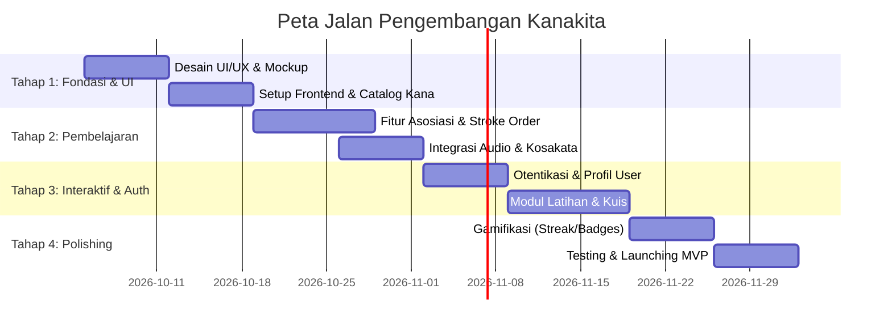

# Document Requirement Product (PRD): Kanakita

**Nama Produk:** Kanakita  
**Versi:** 1.0.0  
**Tanggal:** 2 Oktober 2026  
**Status:** Draf Final  

---

## 1. Ringkasan Eksekutif & Visi Produk

### 1.1 Visi
**Kanakita** adalah platform pembelajaran berbasis web yang dirancang khusus untuk pemula yang ingin menguasai sistem penulisan bahasa Jepang—**Hiragana** dan **Katakana**—secara mudah, interaktif, dan menyenangkan. Katalog huruf, audio pelafalan, animasi urutan goresan (*stroke order*), dan kuis membantu pembelajar mengenali serta mengingat Kana.

### 1.2 Masalah yang Diselesaikan
* **Kesulitan Mengingat Huruf:** Pemula membutuhkan latihan langsung untuk mengenali dan mengingat Kana (Hiragana & Katakana).
* **Kurangnya Panduan Menulis Interaktif:** Pembelajar sering salah dalam urutan goresan (*stroke order*), yang mempengaruhi kerapian dan keabsahan penulisan.
* **Metode Belajar Pasif:** Media belajar konvensional kurang menyediakan latihan interaktif dan pengukuran progres secara *real-time*.

### 1.3 Solusi Produk
Kanakita menghadirkan katalog Kana, audio pelafalan, latihan menulis step-by-step, contoh kosakata terintegrasi, serta kuis tergamifikasi untuk memotivasi pengguna.

---

## 2. Target Audiens & User Persona

### 2.1 Target Audiens
* **Siswa/Mahasiswa:** Yang sedang mempelajari bahasa Jepang pemula (N5 / Dasar).
* **Penggemar Budaya Jepang:** Komunitas anime, manga, game yang ingin membaca Kana secara mandiri.
* **Calon Peserta Magang/Kerja ke Jepang:** Orang dewasa muda yang membutuhkan fondasi baca-tulis Kana dengan cepat.

### 2.2 User Persona (Contoh)
* **Nama:** Budi (19 Tahun, Mahasiswa)
* **Tujuan:** Ingin bisa membaca Hiragana dan Katakana dalam kurun waktu 2 minggu tanpa merasa bosan.
* **Kebutuhan:** Latihan mengenali huruf, audio pelafalan, dan kuis singkat untuk evaluasi harian saat luang.

---

## 3. Fitur Utama & Spesifikasi Fungsional

### F-01: Otentikasi Pengguna & Profil
| ID Fitur | Nama Fitur | Deskripsi & Aturan Bisnis |
| :--- | :--- | :--- |
| **F-01.1** | Register | Pengguna dapat mendaftar akun baru menggunakan Email/Password atau *OAuth* (Google). Validasi email dan enkripsi password aman. |
| **F-01.2** | Login / Logout | Pengguna dapat masuk ke akun mereka dan tetap *logged in* (JWT / Session token). |
| **F-01.3** | Dashboard Profil | Menampilkan data statistik belajar: jumlah huruf yang sudah dikuasai, *streak* harian, skor kuis tertinggi, dan riwayat aktivitas. |

---

### F-02: Modul Katalog & Detail Huruf (Melihat Huruf)
| ID Fitur | Nama Fitur | Deskripsi & Aturan Bisnis |
| :--- | :--- | :--- |
| **F-02.1** | Grid Tabel Kana | Menampilkan matriks lengkap Gojūon (46 huruf dasar + Dakuten/Handakuten + Yoon) untuk Hiragana dan Katakana dengan filter per kategori. |
| **F-02.2** | Audio Pelafalan | Mengklik kartu huruf akan memutar audio suara penutur asli (*native speaker audio*) untuk pelafalan rasio *romaji*. |
| **F-02.3** | Kartu Detail Huruf | Modal / halaman detail yang berisi: Kana, romaji, audio, panduan menulis, dan contoh kosakata yang tersedia dalam Kana. |

---

### F-04: Panduan Cara Menulis (Stroke Order Interaktif)
| ID Fitur | Nama Fitur | Deskripsi & Aturan Bisnis |
| :--- | :--- | :--- |
| **F-04.1** | Animasi Goresan | SVG animasi step-by-step yang memperlihatkan urutan & arah goresan (*stroke order*) huruf. |
| **F-04.2** | Canvas Latihan Tangan | Pengguna dapat berlatih menulis langsung di layar (touchscreen / mouse canvas) dengan petunjuk arah titik. |
| **F-04.3** | Feedback Penulisan | Evaluasi presisi goresan sederhana (kemiripan pola/arah). |

---

### F-05: Contoh Huruf dalam Kosakata
| ID Fitur | Nama Fitur | Deskripsi & Aturan Bisnis |
| :--- | :--- | :--- |
| **F-05.1** | Daftar Kosakata Contoh | Setiap karakter menyajikan contoh kosakata yang tersedia dari dataset dan ditulis hanya dalam Kana (Contoh: あ -> あめ (*Ame* / Hujan)). |
| **F-05.2** | Kategori Hiragana & Katakana | Pengguna dapat memisahkan daftar kosakata berdasarkan sistem tulisan Hiragana atau Katakana. Setiap daftar menampilkan contoh yang tersedia untuk tiap karakter. |

---

### F-06: Modul Latihan Soal (Practice Mode)
| ID Fitur | Nama Fitur | Deskripsi & Aturan Bisnis |
| :--- | :--- | :--- |
| **F-06.1** | Flashcard Interaktif | Kartu bolak-balik untuk menguji ingatan huruf ke Romaji atau sebaliknya. |
| **F-06.2** | Latihan Pencocokan | Mode *Drag and Drop* atau *Matching Pair* antara huruf Kana dan Romaji / gambar asosiasi. |
| **F-06.3** | Latihan per-Baris | Pengguna dapat memilih sesi latihan tertentu (e.g., baris A-I-U-E-O saja, atau baris KA-KI-KU-KE-KO saja). |

---

### F-07: Sistem Kuis & Evaluasi (Quiz & Gamification)
| ID Fitur | Nama Fitur | Deskripsi & Aturan Bisnis |
| :--- | :--- | :--- |
| **F-07.1** | Mode Kuis Waktu | Kuis pilihan ganda / ketik jawaban dengan pembatas waktu (*timer*). |
| **F-07.2** | Kuis Hiragana vs Katakana | Pilihan kuis khusus Hiragana, Katakana, atau campuran keduanya. |
| **F-07.3** | Scoring & Rank Badges | Perhitungan nilai *accuracy rate*, skor akhir, serta pembukaan *lencana kelulusan* (*badges*) untuk memotivasi pengguna. |
| **F-07.4** | Peninjauan Ulang (Review) | Halaman rangkuman di akhir kuis yang menampilkan huruf-huruf mana saja yang sering salah dijawab pengguna. |

---

## 4. Arsitektur Teknis & Spesifikasi UI/UX

### 4.1 Tech Stack Recommendation
* **Frontend:** React / Next.js / Vite + Tailwind CSS / Vanilla CSS dengan Web Animations & Canvas API.
* **Backend:** Node.js (Express / NestJS) atau Supabase / Firebase backend-as-a-service.
* **Database:** PostgreSQL / MongoDB untuk menyimpan data pengguna, progres belajar, dan hasil kuis.
* **Media Assets:** Asset SVG untuk huruf & stroke order animations dan MP3 untuk audio pelafalan.

### 4.2 Desain UI/UX & Tema Visual
* **Gaya Visual:** Modern, Clean, *Japandi Aesthetics* dengan sentuhan warna pastel yang bersahabat & fokus.
* **Palette Warna:**
  * Primary: Soft Crimson / Sakura Pink (`#FF6B81` / `#E84118`)
  * Secondary: Warm Sand / Cream (`#F5F6FA` / `#DFE4EA`)
  * Accent: Bamboo Green / Indigo Blue (`#2ED573` / `#3742FA`)
  * Text & Background: Dark Charcoal (`#2F3542`) & Crisp White (`#FFFFFF`)
* **Typografi:** Font sans-serif bersih modern seperti *Outfit* atau *Inter* dikombinasikan dengan font Jepang *Noto Sans JP* atau *Zen Maru Gothic*.

---

## 5. Requirements Non-Fungsional

1. **Performansi:** Waktu muat halaman (*Page Load Speed*) di bawah 2 detik. Aset audio dan gambar diringkas (WebP / WebAudio API).
2. **Responsivitas Mobile:** Tampilan 100% responsif di layar Smartphone, Tablet, dan Desktop.
3. **Aksesibilitas (a11y):** Dukungan keyboard navigation dan screen-reader label untuk tombol audio.
4. **Keamanan Data:** Proteksi kredensial login (bcrypt hashing), sanitasi input untuk kuis/pencarian, HTTPS mandatori.

---

## 6. Peta Jalan Pengembangan (Roadmap)

---

## 7. Metrik Keberhasilan (KPI)
* **Monthly Active Users (MAU):** Pertumbuhan pengguna aktif bulanan.
* **Completion Rate:** Persentase pengguna yang menyelesaikan modul Hiragana dan Katakana.
* **Average Quiz Accuracy:** Rata-rata nilai kuis pengguna yang meningkat seiring waktu.
* **User Retention Rate:** Jumlah pengguna yang kembali berlatih dalam kurun waktu 7 hari (*7-day retention*).

---
*Dokumen ini dibuat untuk memandu tim pengembangan software dan desain UI/UX dalam merealisasikan platform Kanakita.*
